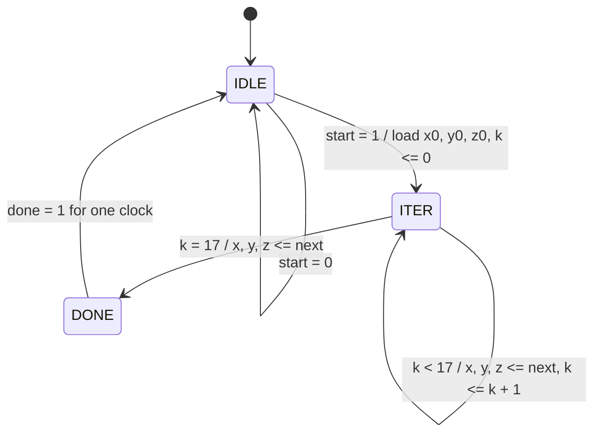

# CORDIC Hyperbolic on FPGA — Implementation Compendium

As of 2026-11-10. Compiled from the papers in `papers/`, the course textbooks in `../` (section 7), and a bit-exact sweep of `cordic-sim/cordic.js`.

**Recommendation:** use an **18-bit Q2.16 datapath (16 fraction bits) with 18 iterations**. On all six functions (cosh, sinh, exp, atanh, ln, sqrt) the worst case is **≥ 12.3 bits** of accuracy. The cheaper option is 16-bit Q2.14 with 16 iterations, which gives ≥ 10.3 bits.

---

## 1. Sources

| Ref | Source | What it contributes |
| --- | --- | --- |
| [DM] | H. Dawid, H. Meyr, "CORDIC Algorithms and Architectures", Ch. 24 (`cordic_chap24.pdf`) | The unified iteration, shift sequences (Tab. 24.1), guard-bit format (Fig. 24.7), rounding vs truncation, and the iterative/unrolled/pipelined comparison (Tab. 24.3) |
| [MB] | U. Meyer-Baese, *Digital Signal Processing with FPGAs*, Sec. 2.9 | Hyperbolic repeats 4, 13, 40, 121; the log2(b) guard-bit rule; the hyperbolic precision surface (Fig. 2.44); LE costs (Tab. 2.13); an 8-bit pipelined VHDL example |
| [BG] | A. Boudabous et al., "Implementation of Hyperbolic Functions Using CORDIC Algorithm" | An iterative VHDL core on Virtex-E: ln uses 177 slices at 70 MHz, exp uses 261 slices at 71 MHz. Range extension for exp via z = z1 + p·ln2 |
| [ZZ] | Z. L. Zhou, "CORDIC Algorithm and its Applications", B.Sc. thesis, Univ. Padova 2023 | A reconfigurable circular/hyperbolic datapath, pipeline chaining, and the word-length rule x,y = n + 2 + log2 n, z = n + log2 n |
| [SIM] | `cordic-sim/cordic.js`, swept over 9 fraction widths × 11 iteration counts × 6 functions, 401 points each | Measured worst-case accuracy and register magnitudes (sections 4 and 6) |
| [BV] | S. Brown, Z. Vranesic, *Fundamentals of Digital Logic with VHDL Design* (`../`) | Fixed-point = integer hardware (3.7.1), add/sub unit (3.3.3), overflow rule (3.3.5), fast adders in FPGAs (3.4), SRA sign extension, barrel shifter (Fig. 4.52), Fmax and clock skew (5.15), datapath + ASM controller (Ch. 7) |
| [WK] | J. Wakerly, *Digital Design: Principles and Practices*, 2006 (`../`) | Barrel-shifter trade-offs (6.1.1, Tab. 6-1), log-stage mux cascade (Fig. 6-2), structural VHDL shifters (Tab. 6-18 to 6-22), two's-complement arithmetic (2.6) |
| [MC] | M. Mano, M. Ciletti, *Digital Design*, 6th ed. (`../`) | RTL design with ASMD charts (Ch. 8), sequential multiplier as a datapath + controller template (8.7 to 8.9), ROM (7.5), one-hot state encoding for FPGAs |

None of the three textbooks mentions CORDIC. They supply the building blocks the core is made of. Rabaey's *Digital Integrated Circuits* (also in `../`) lists barrel and logarithmic shifters (11.5) in its contents, but that chapter's text did not extract from the PDF, so it is not used.

> Note: the 1.7 MB PDF in `papers/` named `Fundamentals of Digital Logic with VHDL Design (...).pdf` is the Zhou thesis [ZZ]. The real Brown–Vranesic book is the 17 MB file in `../`.

---

## 2. Algorithm

In hyperbolic mode (m = −1), each iteration needs two shifts, three add/subtracts and one atanh constant. Shifts start at 1 because atanh(2⁰) = ∞ [DM, MB].

```
x[i+1] = x[i] + d[i] · (y[i] >>> s[i])
y[i+1] = y[i] + d[i] · (x[i] >>> s[i])
z[i+1] = z[i] − d[i] · atanh(2^−s[i])
```

- **Rotation mode:** d = sign(z), which drives z → 0.
- **Vectoring mode:** d = −sign(y) for x > 0, which drives y → 0.

| Mode | Inputs (x0, y0, z0) | Outputs after n iterations | Functions |
| --- | --- | --- | --- |
| Rotation | 1/K, 0, t | x = cosh t, y = sinh t | cosh, sinh, exp = x + y, tanh = y/x (needs a divider) |
| Vectoring | 1, a, 0 | z = atanh a | atanh |
| Vectoring | w+1, w−1, 0 | z = ½ ln w | ln w = 2z (one left shift) |
| Vectoring | w+¼, w−¼, 0 | x = K·√w | √w = x · (1/K) (one constant multiply) |

### Repeated iterations (mandatory)

Without repeats the hyperbolic CORDIC does **not converge**, because the atanh angles shrink too fast. Shifts 4, 13, 40, … (k → 3k+1) must each run twice [MB, DM, ZZ].

| n (iterations) | Shift schedule |
| --- | --- |
| 16 | 1 2 3 4 **4** 5 6 7 8 9 10 11 12 13 **13** 14 |
| 18 | 1 2 3 4 **4** 5 6 7 8 9 10 11 12 13 **13** 14 15 16 |

### Gain

Every iteration also scales the vector by √(1 − 2^(−2s)). The total over the schedule is **K = 0.828159 and 1/K = 1.207497**, stable to 6 digits for n ≥ 14. [MB]'s table rounds K to 0.80 and [DM] gives 0.82816. Pre-load x0 = 1/K in rotation mode, so cosh and sinh need no output multiply.

| Format | 1/K constant |
| --- | --- |
| Q2.14 | 19784 (0x4D48) |
| Q2.16 | 79135 (0x1351F) |

---

## 3. Convergence range and range extension

The raw core converges only for |t| ≤ Σ atanh(2^−s) = **1.1181**. [DM] gives about 1.13.

| Function | Valid input, raw core | Range-extension trick |
| --- | --- | --- |
| cosh, sinh, exp | \|t\| ≤ 1.1181 | exp: t = p·ln2 + r with p = round(t/ln2) and \|r\| ≤ 0.347, then e^t = e^r << p [BG]. cosh/sinh: build from e^t and e^−t |
| atanh | \|a\| ≤ 0.8069 | Rarely needed |
| ln w | 0.1069 ≤ w ≤ 9.358 | w = M·2^E with M ∈ [0.5, 1), then ln w = ln M + E·ln2. This also keeps x, y < 2, so the datapath stays Q2.F |
| √w | 0.0267 ≤ w ≤ 2.339 | w = M·4^E, then √w = √M << E |

Without range reduction, ln needs 5 integer bits because x0 = w+1 reaches 10.3. That costs 3 extra bits on every register. Range reduction needs only a leading-one detector and a shifter. Use it, and one Q2.F core serves every function.

---

## 4. Word length: total bits, fraction bits, iterations

Two rules come out of the sweep [SIM]:

- **Accuracy:** the worst case is about F − 4 bits, where F is the number of fraction bits.
- **Iterations:** the best iteration count is n = F + 2, so the last shift equals F.

How the sweep measures accuracy:

- Accuracy is −log2 of the largest absolute error over 401 points.
- Each row reports the weakest of the six functions.
- The model shifts with an arithmetic right shift (floor), the same as Verilog `>>>`.

| Target accuracy | Fraction bits F | Iterations n | x, y, z width (2 int + F) | Measured worst (bits) | Weakest function |
| --- | --- | --- | --- | --- | --- |
| 8 bit | 12 | 12 | 14 (Q2.12) | 8.3 | atanh |
| 10 bit | 14 | 16 | 16 (Q2.14) | 10.3 | ln |
| **12 bit** | **16** | **18** | **18 (Q2.16)** | **12.3** | exp |
| 14 bit | 18 | 20 | 20 (Q2.18) | 14.1 | ln |
| 16 bit | 20 | 22 | 22 (Q2.20) | 15.8 | ln |
| 18 bit | 22 | 24 | 24 (Q2.22) | 18.1 | sqrt |
| 20 bit | 24 | 26 | 26 (Q2.24) | 20.0 | exp |

### Integer bits

| Function | Peak register magnitude | Format needed |
| --- | --- | --- |
| cosh / sinh / exp (rotation) | 1.672 | Q2 (sign + 1 int bit) |
| atanh | 1.102 | Q2 |
| sqrt (raw) | 2.55 | Q3 → Q2 with range reduction |
| ln (raw) | 10.30 | Q5 → Q2 with range reduction |

The output adder for exp = x + y reaches 3.06 at t = 1.118, so give that adder alone one extra bit.

### Z path

Use the same F for z as for x and y [MB]. Each atanh constant is rounded to F bits, and extra z bits buy nothing.

### More iterations past F + 2 hurt

Past n = F + 2, each extra stage adds truncation error but no new angle resolution. At F = 14, raising n from 16 to 28 drops the worst case from 10.3 to 9.2 bits.

### Cross-check against the papers

- **[MB] guard-bit rule:** b + log2(b) fraction bits. For b = 12 that is 15.6, so F = 16. Matches.
- **[ZZ]** (citing Dawid–Meyr 1996): x,y width = b + 2 + log2(b). For b = 12 that is 17.6, so 18 bits = Q2.16. Matches.
- **[DM]:** the last shift should equal W, plus about log2(n) LSB guard bits for rounding. Consistent with F − 4.
- **[MB] Fig. 2.44** is more pessimistic. It reports 10 bits from a 21-bit x/y path with 18 iterations, or 24 bits with 14. Its test range and error metric are not stated. Check your final HDL against the model.

### Possible gains (not measured)

- **Rounding instead of truncation:** [DM] says this halves the maximum error and removes truncation's positive bias. Expect about +1 bit, at the cost of a carry-in on each adder.
- **sqrt converges early:** at F = 20 it reaches 17 bits after only 10 iterations, because magnitude error is second-order in the leftover angle. A sqrt-only core can stop early.

---

## 5. FPGA architecture

| Architecture | Clock period | Throughput | Latency | Area [DM Tab. 24.3] |
| --- | --- | --- | --- | --- |
| Iterative (folded) | T_add + T_shift | 1 result / n cycles | n cycles | 3 adders, 2 barrel shifters, 3 regs, atanh ROM |
| Unrolled, combinational | n·T_add | 1 / (n·T_add) | 1 | 3n adders |
| Unrolled, pipelined | T_add | 1 result / cycle | n cycles | 3n adders, 3n registers, shifts and constants hard-wired |

### Iterative core

[BG] and [MB] Fig. 2.45 describe the same structure:

- One stage computes one iteration per clock.
- Two **barrel shifters** shift x and y by s[i]. In [MB] they are the most complex part of the design.
- An **atanh ROM** holds the angles, addressed by the iteration counter.
- Because of the repeats, the **shift amount ≠ counter value**. Store s[i] in a small ROM alongside atanh, or have the counter hold on 4 and 13.
- [BG] measured an iterative design on Virtex-E XCV50E: ln uses 177 slices at 70 MHz, exp uses 261 slices at 71 MHz.

### Pipelined core

[MB] Fig. 2.47 and [ZZ] Fig. 2.6 describe the pipelined version:

- The core is n copies of one stage.
- Shifts are plain wiring and each atanh is a constant, so there are no ROMs and no barrel shifters [DM].
- Measured example: an 8-bit, 4-stage pipelined core takes 276 LEs and runs at 209.6 MHz with no embedded multipliers [MB].
- LE count grows quadratically with width [MB].
- An N-bit switchable add/sub costs about 2N LEs on 3-input fast-arithmetic LEs [MB].

### Shifter options for small FPGAs

[MB] Tab. 2.13 compares shifter options for a 13-bit + sign iterative core on Xilinx XC3K:

| Structure | LEs | Cycles per result |
| --- | --- | --- |
| 2 barrel shifters + 2 accumulators | 81 | 12 |
| 2 serial right shifters + 2 acc | 55 | 46 |
| 1 barrel shifter + 2 acc | 75.5 | 20 |
| 1 barrel shifter + 1 acc | 68.5 | 20 |

### Reconfigurable circular + hyperbolic core

To support both modes in one datapath [ZZ]:

- The two modes differ only in the sign of the x-update and in the angle table.
- Add a trajectory bit `t` (1 = circular, 0 = hyperbolic) and a `mode` bit (1 = vectoring).
- Two ROMs supply the angles: atanh(2^−i) for hyperbolic mode and atan(2^−i) for circular mode.

### Atanh table, Q2.16 (value × 2^16, rounded)

Generated with `cordic.js`:

| shift | 1 | 2 | 3 | 4 | 4 | 5 | 6 | 7 | 8 | 9 | 10 | 11 | 12 | 13 | 13 | 14 | 15 | 16 |
|---|---|---|---|---|---|---|---|---|---|---|---|---|---|---|---|---|---|---|
| value | 35999 | 16739 | 8235 | 4101 | 4101 | 2049 | 1024 | 512 | 256 | 128 | 64 | 32 | 16 | 8 | 8 | 4 | 2 | 1 |

### One pipeline stage (Verilog sketch)

```verilog
// Stage k: shift S is a parameter (hard-wired), A = atanh(2^-S) in Q2.16
module hcordic_stage #(parameter W = 18, S = 1, A = 35999, ROT = 1) (
  input  wire                clk,
  input  wire signed [W-1:0] xi, yi, zi,
  output reg  signed [W-1:0] xo, yo, zo
);
  wire d = ROT ? ~zi[W-1] : yi[W-1];  // 1 => d = +1
  always @(posedge clk) begin
    xo <= d ? xi + (yi >>> S) : xi - (yi >>> S);
    yo <= d ? yi + (xi >>> S) : yi - (xi >>> S);
    zo <= d ? zi - A          : zi + A;
  end
endmodule
```

Instantiate 18 stages with S = 1,2,3,4,4,5,…,13,13,14,15,16, taking A from the table above.

---

## 6. Recommended parameters and verification plan

| Parameter | Value |
| --- | --- |
| Number format | Two's complement, Q2.16 (18 bits) for x, y, z |
| Iterations | 18 (shifts 1…16 with 4 and 13 repeated) |
| 1/K preload | 79135 (0x1351F) |
| Input range (raw) | \|t\| ≤ 1.118 (rotation), \|a\| ≤ 0.807 (atanh) |
| Range reduction | Needed for exp outside ±1.118 and for ln/sqrt outside the table in section 3 |
| Expected accuracy | ≥ 12.3 bits worst case (cosh 13.2, sinh 13.2, exp 12.3, atanh 12.8, ln 12.5, sqrt 12.5) |
| Architecture | Iterative if area matters (≈3 adders + 2 barrel shifters + 18-word ROM); pipelined if 1 result/clock is needed (≈54 add/subs of 18 bits, ≈972 FFs, estimate) |
| Budget option | Q2.14, 16 iterations, ≥ 10.3 bits |

### Verification plan (TDD)

1. **Golden vectors:** run `cordic.js` in fixed mode with `{frac: 16, width: 18}` and n = 18 to export (input, x, y, z) per stage. The model is bit-exact integer math, so the HDL must match it **exactly**, not merely approximately.
2. **Testbench:** read the vectors, drive the core, and assert equality at every stage. A per-stage mismatch locates the faulty iteration directly.
3. **Edge cases:**
   - t = ±1.118 and ±1.2 (out of range must be flagged).
   - The repeated stages 4 and 13.
   - Overflow wrap at the Q2 limit.
   - w at the ln/sqrt domain edges.
4. **Accuracy check:** compare the HDL output against `Math.cosh`, `Math.log`, etc. and confirm the worst case is ≥ 12 bits across the full input grid.
5. **Synthesis:** record LUTs, FFs and Fmax for both architectures, to compare with [BG] and [MB].

---

## 7. Building blocks from the course textbooks

The CORDIC core is built from five standard blocks: registers, adder/subtractors, arithmetic shifters, a ROM and a controller. Each block maps onto a chapter of the course books.

| Block | What the CORDIC needs | Textbook guidance |
| --- | --- | --- |
| Number format | Q2.16 two's complement | Fixed-point numbers use the same circuits as integers; the binary point is only a convention [BV 3.7.1]. Use plain `signed` adders and registers |
| Arithmetic right shift | `x >>> s` must copy the sign bit into the vacated MSBs | SRA "performs the sign extension by replicating the sign bit" [BV]. A logical shift (zero-fill) of a negative y gives a large positive number and the CORDIC diverges. Declare regs `signed` in Verilog and use `>>>`; in VHDL use `shift_right` on `signed` |
| Add/subtract | x ± (y >>> s), steered by d | Add/sub unit = adder with B XOR sub and carry-in = sub [BV 3.3.3]. The CORDIC direction bit d drives `sub` directly |
| Fast adder | 18-bit add in one clock | FPGAs include dedicated fast-carry circuitry [BV 3.4]. Write `a + b` and let synthesis map it to the carry chain; do not hand-build a carry-lookahead adder |
| Overflow detect | Flag out-of-range inputs | Overflow occurs when both operands have the same sign and the sum has a different sign [BV 3.3.5]. One XOR per adder; matches the `overflow` flag in `cordic.js` |
| Barrel shifter (iterative core only) | Shift by 1…16 | A cascade of log2 stages of 2:1 muxes (shift by 1, 2, 4, 8, ...) halves the parts count and loading compared with one big mux per bit, at the cost of more levels of delay [WK 6.1.1, Fig. 6-2, Tab. 6-1]. For 1…16 that is 5 stages × 18 bits = 90 2:1 muxes per shifter, 180 for x and y |
| Shifter coding style | Predictable synthesis | Wakerly writes the shifter as one `if` per stage so synthesis builds exactly that cascade, rather than relying on a loop with a variable range [WK Tab. 6-18] |
| Angle + shift ROM | 18 words: atanh(2^−s) (18 bits) and s (5 bits) | ROM as a truth table addressed by the iteration counter [MC 7.5]. On an FPGA a `case` statement infers it in LUTs |
| Controller | Load → 18 iterations → done | Datapath + controller designed from an ASM/ASMD chart [BV Ch. 7, MC Ch. 8]. Structurally identical to the sequential shift-and-add multiplier: a counter, a done flag, and registers that update every clock [MC 8.7–8.9, BV Fig. 7.23] |
| State encoding | 3 states | One-hot suits register-rich FPGAs and often gives simpler next-state logic [MC 5] |
| Timing | Fmax | T_min = t_cQ + t_logic + t_su over every flip-flop-to-flip-flop path [BV 5.15]. Iterative: t_logic = 5 mux levels + adder + register mux. Pipelined: t_logic = one adder, hence the higher Fmax in [DM Tab. 24.3] |

### Iterative core: ASM chart



The ROM is addressed by k, not by the shift amount. With k counting from 0, entries 3 and 4 both hold shift 4, and entries 13 and 14 both hold shift 13. This is how the repeated iterations are handled with no extra control logic.

### Logarithmic arithmetic shifter (Verilog)

```verilog
// Wakerly-style log shifter, arithmetic (sign-fill) right shift by s = 0..31
module ashr18 (
  input  wire signed [17:0] a,
  input  wire        [4:0]  s,
  output wire signed [17:0] y
);
  wire signed [17:0] t0 = s[0] ? a  >>> 1  : a;
  wire signed [17:0] t1 = s[1] ? t0 >>> 2  : t0;
  wire signed [17:0] t2 = s[2] ? t1 >>> 4  : t1;
  wire signed [17:0] t3 = s[3] ? t2 >>> 8  : t2;
  assign             y  = s[4] ? t3 >>> 16 : t3;
endmodule
```

Each stage shifts by a constant, so each is just wires plus 18 2:1 muxes. Modern synthesis tools also accept `a >>> s` with a variable `s` and build a similar cascade; the explicit version makes the 5 stages visible in timing reports.
