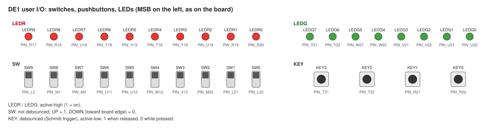
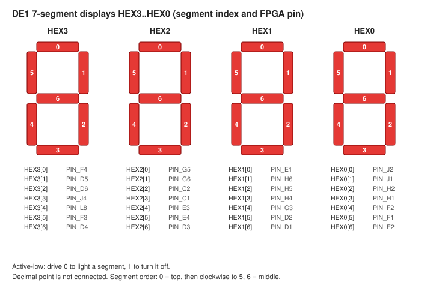
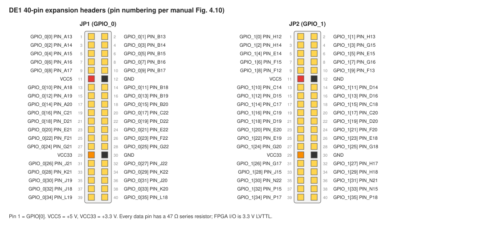

# DE1 board pin reference (Cyclone II EP2C20F484C7)

Pins come from the official Quartus file [DE1_pin_assignments.csv](DE1_pin_assignments.csv). Descriptions
and table numbers come from the [DE1 User Manual v1.0](DE1_UserManual_v1017.pdf), chapter 4. Every I/O
uses the 3.3-V LVTTL standard.

**Using it in Quartus:** Assignments → Import Assignments → `DE1_pin_assignments.csv`. Your top-level
port names must match the signal names below exactly (e.g. `SW[0]`, `HEX0[6]`, `CLOCK_50`).

## Polarity at a glance

| Device | Signals | Logic |
|---|---|---|
| Toggle switches | `SW[9:0]` | UP = 1, DOWN = 0. Not debounced. |
| Pushbuttons | `KEY[3:0]` | Active-low: 0 while pressed. Debounced, safe to use as a clock. |
| Red / green LEDs | `LEDR[9:0]`, `LEDG[7:0]` | Active-high: 1 = on. |
| 7-segment | `HEX0[6:0]` … `HEX3[6:0]` | Active-low: 0 = segment on. Decimal point not connected. |

## Switches, pushbuttons and LEDs

### Toggle switches (Table 4.1)

| Signal | FPGA pin | Description |
|---|---|---|
| `SW[0]` | `PIN_L22` | Toggle Switch[0] |
| `SW[1]` | `PIN_L21` | Toggle Switch[1] |
| `SW[2]` | `PIN_M22` | Toggle Switch[2] |
| `SW[3]` | `PIN_V12` | Toggle Switch[3] |
| `SW[4]` | `PIN_W12` | Toggle Switch[4] |
| `SW[5]` | `PIN_U12` | Toggle Switch[5] |
| `SW[6]` | `PIN_U11` | Toggle Switch[6] |
| `SW[7]` | `PIN_M2` | Toggle Switch[7] |
| `SW[8]` | `PIN_M1` | Toggle Switch[8] |
| `SW[9]` | `PIN_L2` | Toggle Switch[9] |

### Pushbuttons (Table 4.2)

| Signal | FPGA pin | Description |
|---|---|---|
| `KEY[0]` | `PIN_R22` | Pushbutton[0] |
| `KEY[1]` | `PIN_R21` | Pushbutton[1] |
| `KEY[2]` | `PIN_T22` | Pushbutton[2] |
| `KEY[3]` | `PIN_T21` | Pushbutton[3] |

### LEDs (Table 4.3)

| Signal | FPGA pin | Description |
|---|---|---|
| `LEDR[0]` | `PIN_R20` | LED Red[0] |
| `LEDR[1]` | `PIN_R19` | LED Red[1] |
| `LEDR[2]` | `PIN_U19` | LED Red[2] |
| `LEDR[3]` | `PIN_Y19` | LED Red[3] |
| `LEDR[4]` | `PIN_T18` | LED Red[4] |
| `LEDR[5]` | `PIN_V19` | LED Red[5] |
| `LEDR[6]` | `PIN_Y18` | LED Red[6] |
| `LEDR[7]` | `PIN_U18` | LED Red[7] |
| `LEDR[8]` | `PIN_R18` | LED Red[8] |
| `LEDR[9]` | `PIN_R17` | LED Red[9] |
| `LEDG[0]` | `PIN_U22` | LED Green[0] |
| `LEDG[1]` | `PIN_U21` | LED Green[1] |
| `LEDG[2]` | `PIN_V22` | LED Green[2] |
| `LEDG[3]` | `PIN_V21` | LED Green[3] |
| `LEDG[4]` | `PIN_W22` | LED Green[4] |
| `LEDG[5]` | `PIN_W21` | LED Green[5] |
| `LEDG[6]` | `PIN_Y22` | LED Green[6] |
| `LEDG[7]` | `PIN_Y21` | LED Green[7] |

## 7-segment displays (Table 4.4)

Segment `[0]` is the top segment, `[1]`–`[5]` go clockwise, `[6]` is the middle.

| Display | [0] | [1] | [2] | [3] | [4] | [5] | [6] |
|---|---|---|---|---|---|---|---|
| `HEX0` | `PIN_J2` | `PIN_J1` | `PIN_H2` | `PIN_H1` | `PIN_F2` | `PIN_F1` | `PIN_E2` |
| `HEX1` | `PIN_E1` | `PIN_H6` | `PIN_H5` | `PIN_H4` | `PIN_G3` | `PIN_D2` | `PIN_D1` |
| `HEX2` | `PIN_G5` | `PIN_G6` | `PIN_C2` | `PIN_C1` | `PIN_E3` | `PIN_E4` | `PIN_D3` |
| `HEX3` | `PIN_F4` | `PIN_D5` | `PIN_D6` | `PIN_J4` | `PIN_L8` | `PIN_F3` | `PIN_D4` |

## Clock inputs (Table 4.5)

| Signal | FPGA pin | Description |
|---|---|---|
| `CLOCK_27[0]` | `PIN_D12` | 27 MHz clock input |
| `CLOCK_27[1]` | `PIN_E12` | 27 MHz clock input |
| `CLOCK_50` | `PIN_L1` | 50 MHz clock input |
| `CLOCK_24[0]` | `PIN_B12` | 24 MHz clock input from USB Blaster (manual lists A12/B12 in the other order; pin here is from the official CSV) |
| `CLOCK_24[1]` | `PIN_A12` | 24 MHz clock input from USB Blaster (manual lists A12/B12 in the other order; pin here is from the official CSV) |
| `EXT_CLOCK` | `PIN_M21` | External (SMA) clock input |

## Expansion headers GPIO_0 / GPIO_1 (Table 4.7)

| Header pin | `GPIO_0` (JP1) | FPGA pin | `GPIO_1` (JP2) | FPGA pin |
|---|---|---|---|---|
| 1 | `GPIO_0[0]` | `PIN_A13` | `GPIO_1[0]` | `PIN_H12` |
| 2 | `GPIO_0[1]` | `PIN_B13` | `GPIO_1[1]` | `PIN_H13` |
| 3 | `GPIO_0[2]` | `PIN_A14` | `GPIO_1[2]` | `PIN_H14` |
| 4 | `GPIO_0[3]` | `PIN_B14` | `GPIO_1[3]` | `PIN_G15` |
| 5 | `GPIO_0[4]` | `PIN_A15` | `GPIO_1[4]` | `PIN_E14` |
| 6 | `GPIO_0[5]` | `PIN_B15` | `GPIO_1[5]` | `PIN_E15` |
| 7 | `GPIO_0[6]` | `PIN_A16` | `GPIO_1[6]` | `PIN_F15` |
| 8 | `GPIO_0[7]` | `PIN_B16` | `GPIO_1[7]` | `PIN_G16` |
| 9 | `GPIO_0[8]` | `PIN_A17` | `GPIO_1[8]` | `PIN_F12` |
| 10 | `GPIO_0[9]` | `PIN_B17` | `GPIO_1[9]` | `PIN_F13` |
| 11 | VCC5 | | VCC5 | |
| 12 | GND | | GND | |
| 13 | `GPIO_0[10]` | `PIN_A18` | `GPIO_1[10]` | `PIN_C14` |
| 14 | `GPIO_0[11]` | `PIN_B18` | `GPIO_1[11]` | `PIN_D14` |
| 15 | `GPIO_0[12]` | `PIN_A19` | `GPIO_1[12]` | `PIN_D15` |
| 16 | `GPIO_0[13]` | `PIN_B19` | `GPIO_1[13]` | `PIN_D16` |
| 17 | `GPIO_0[14]` | `PIN_A20` | `GPIO_1[14]` | `PIN_C17` |
| 18 | `GPIO_0[15]` | `PIN_B20` | `GPIO_1[15]` | `PIN_C18` |
| 19 | `GPIO_0[16]` | `PIN_C21` | `GPIO_1[16]` | `PIN_C19` |
| 20 | `GPIO_0[17]` | `PIN_C22` | `GPIO_1[17]` | `PIN_C20` |
| 21 | `GPIO_0[18]` | `PIN_D21` | `GPIO_1[18]` | `PIN_D19` |
| 22 | `GPIO_0[19]` | `PIN_D22` | `GPIO_1[19]` | `PIN_D20` |
| 23 | `GPIO_0[20]` | `PIN_E21` | `GPIO_1[20]` | `PIN_E20` |
| 24 | `GPIO_0[21]` | `PIN_E22` | `GPIO_1[21]` | `PIN_F20` |
| 25 | `GPIO_0[22]` | `PIN_F21` | `GPIO_1[22]` | `PIN_E19` |
| 26 | `GPIO_0[23]` | `PIN_F22` | `GPIO_1[23]` | `PIN_E18` |
| 27 | `GPIO_0[24]` | `PIN_G21` | `GPIO_1[24]` | `PIN_G20` |
| 28 | `GPIO_0[25]` | `PIN_G22` | `GPIO_1[25]` | `PIN_G18` |
| 29 | VCC33 | | VCC33 | |
| 30 | GND | | GND | |
| 31 | `GPIO_0[26]` | `PIN_J21` | `GPIO_1[26]` | `PIN_G17` |
| 32 | `GPIO_0[27]` | `PIN_J22` | `GPIO_1[27]` | `PIN_H17` |
| 33 | `GPIO_0[28]` | `PIN_K21` | `GPIO_1[28]` | `PIN_J15` |
| 34 | `GPIO_0[29]` | `PIN_K22` | `GPIO_1[29]` | `PIN_H18` |
| 35 | `GPIO_0[30]` | `PIN_J19` | `GPIO_1[30]` | `PIN_N22` |
| 36 | `GPIO_0[31]` | `PIN_J20` | `GPIO_1[31]` | `PIN_N21` |
| 37 | `GPIO_0[32]` | `PIN_J18` | `GPIO_1[32]` | `PIN_P15` |
| 38 | `GPIO_0[33]` | `PIN_K20` | `GPIO_1[33]` | `PIN_N15` |
| 39 | `GPIO_0[34]` | `PIN_L19` | `GPIO_1[34]` | `PIN_P17` |
| 40 | `GPIO_0[35]` | `PIN_L18` | `GPIO_1[35]` | `PIN_P18` |

## VGA (ADV7123 DAC, 4 bit per color) (Table 4.8)

| Signal | FPGA pin | Description |
|---|---|---|
| `VGA_R[0]` | `PIN_D9` | VGA Red[0] |
| `VGA_R[1]` | `PIN_C9` | VGA Red[1] |
| `VGA_R[2]` | `PIN_A7` | VGA Red[2] |
| `VGA_R[3]` | `PIN_B7` | VGA Red[3] |
| `VGA_G[0]` | `PIN_B8` | VGA Green[0] |
| `VGA_G[1]` | `PIN_C10` | VGA Green[1] |
| `VGA_G[2]` | `PIN_B9` | VGA Green[2] |
| `VGA_G[3]` | `PIN_A8` | VGA Green[3] |
| `VGA_B[0]` | `PIN_A9` | VGA Blue[0] |
| `VGA_B[1]` | `PIN_D11` | VGA Blue[1] |
| `VGA_B[2]` | `PIN_A10` | VGA Blue[2] |
| `VGA_B[3]` | `PIN_B10` | VGA Blue[3] |
| `VGA_HS` | `PIN_A11` | VGA H_SYNC |
| `VGA_VS` | `PIN_B11` | VGA V_SYNC |

## Audio CODEC (WM8731) and I²C (Table 4.9)

| Signal | FPGA pin | Description |
|---|---|---|
| `AUD_ADCLRCK` | `PIN_A6` | Audio CODEC ADC LR Clock |
| `AUD_ADCDAT` | `PIN_B6` | Audio CODEC ADC Data |
| `AUD_DACLRCK` | `PIN_A5` | Audio CODEC DAC LR Clock |
| `AUD_DACDAT` | `PIN_B5` | Audio CODEC DAC Data |
| `AUD_XCK` | `PIN_B4` | Audio CODEC Chip Clock |
| `AUD_BCLK` | `PIN_A4` | Audio CODEC Bit-Stream Clock |
| `I2C_SCLK` | `PIN_A3` | I2C Data |
| `I2C_SDAT` | `PIN_B3` | I2C Clock |

## RS-232 (Table 4.10)

| Signal | FPGA pin | Description |
|---|---|---|
| `UART_RXD` | `PIN_F14` | UART Receiver |
| `UART_TXD` | `PIN_G12` | UART Transmitter |

## PS/2 (Table 4.11)

| Signal | FPGA pin | Description |
|---|---|---|
| `PS2_CLK` | `PIN_H15` | PS/2 Clock |
| `PS2_DAT` | `PIN_J14` | PS/2 Data |

## SDRAM (8 MB) (Table 4.16)

| Signal | FPGA pin | Description |
|---|---|---|
| `DRAM_ADDR[0]` | `PIN_W4` | SDRAM Address[0] |
| `DRAM_ADDR[1]` | `PIN_W5` | SDRAM Address[1] |
| `DRAM_ADDR[2]` | `PIN_Y3` | SDRAM Address[2] |
| `DRAM_ADDR[3]` | `PIN_Y4` | SDRAM Address[3] |
| `DRAM_ADDR[4]` | `PIN_R6` | SDRAM Address[4] |
| `DRAM_ADDR[5]` | `PIN_R5` | SDRAM Address[5] |
| `DRAM_ADDR[6]` | `PIN_P6` | SDRAM Address[6] |
| `DRAM_ADDR[7]` | `PIN_P5` | SDRAM Address[7] |
| `DRAM_ADDR[8]` | `PIN_P3` | SDRAM Address[8] |
| `DRAM_ADDR[9]` | `PIN_N4` | SDRAM Address[9] |
| `DRAM_ADDR[10]` | `PIN_W3` | SDRAM Address[10] |
| `DRAM_ADDR[11]` | `PIN_N6` | SDRAM Address[11] |
| `DRAM_DQ[0]` | `PIN_U1` | SDRAM Data[0] |
| `DRAM_DQ[1]` | `PIN_U2` | SDRAM Data[1] |
| `DRAM_DQ[2]` | `PIN_V1` | SDRAM Data[2] |
| `DRAM_DQ[3]` | `PIN_V2` | SDRAM Data[3] |
| `DRAM_DQ[4]` | `PIN_W1` | SDRAM Data[4] |
| `DRAM_DQ[5]` | `PIN_W2` | SDRAM Data[5] |
| `DRAM_DQ[6]` | `PIN_Y1` | SDRAM Data[6] |
| `DRAM_DQ[7]` | `PIN_Y2` | SDRAM Data[7] |
| `DRAM_DQ[8]` | `PIN_N1` | SDRAM Data[8] |
| `DRAM_DQ[9]` | `PIN_N2` | SDRAM Data[9] |
| `DRAM_DQ[10]` | `PIN_P1` | SDRAM Data[10] |
| `DRAM_DQ[11]` | `PIN_P2` | SDRAM Data[11] |
| `DRAM_DQ[12]` | `PIN_R1` | SDRAM Data[12] |
| `DRAM_DQ[13]` | `PIN_R2` | SDRAM Data[13] |
| `DRAM_DQ[14]` | `PIN_T1` | SDRAM Data[14] |
| `DRAM_DQ[15]` | `PIN_T2` | SDRAM Data[15] |
| `DRAM_BA_0` | `PIN_U3` | SDRAM Bank Address[0] |
| `DRAM_BA_1` | `PIN_V4` | SDRAM Bank Address[1] |
| `DRAM_LDQM` | `PIN_R7` | SDRAM Low-byte Data Mask |
| `DRAM_UDQM` | `PIN_M5` | SDRAM High-byte Data Mask |
| `DRAM_RAS_N` | `PIN_T5` | SDRAM Row Address Strobe |
| `DRAM_CAS_N` | `PIN_T3` | SDRAM Column Address Strobe |
| `DRAM_CKE` | `PIN_N3` | SDRAM Clock Enable |
| `DRAM_CLK` | `PIN_U4` | SDRAM Clock |
| `DRAM_WE_N` | `PIN_R8` | SDRAM Write Enable |
| `DRAM_CS_N` | `PIN_T6` | SDRAM Chip Select |

## SRAM (512 KB) (Table 4.17)

| Signal | FPGA pin | Description |
|---|---|---|
| `SRAM_ADDR[0]` | `PIN_AA3` | SRAM Address[0] |
| `SRAM_ADDR[1]` | `PIN_AB3` | SRAM Address[1] |
| `SRAM_ADDR[2]` | `PIN_AA4` | SRAM Address[2] |
| `SRAM_ADDR[3]` | `PIN_AB4` | SRAM Address[3] |
| `SRAM_ADDR[4]` | `PIN_AA5` | SRAM Address[4] |
| `SRAM_ADDR[5]` | `PIN_AB10` | SRAM Address[5] |
| `SRAM_ADDR[6]` | `PIN_AA11` | SRAM Address[6] |
| `SRAM_ADDR[7]` | `PIN_AB11` | SRAM Address[7] |
| `SRAM_ADDR[8]` | `PIN_V11` | SRAM Address[8] |
| `SRAM_ADDR[9]` | `PIN_W11` | SRAM Address[9] |
| `SRAM_ADDR[10]` | `PIN_R11` | SRAM Address[10] |
| `SRAM_ADDR[11]` | `PIN_T11` | SRAM Address[11] |
| `SRAM_ADDR[12]` | `PIN_Y10` | SRAM Address[12] |
| `SRAM_ADDR[13]` | `PIN_U10` | SRAM Address[13] |
| `SRAM_ADDR[14]` | `PIN_R10` | SRAM Address[14] |
| `SRAM_ADDR[15]` | `PIN_T7` | SRAM Address[15] |
| `SRAM_ADDR[16]` | `PIN_Y6` | SRAM Address[16] |
| `SRAM_ADDR[17]` | `PIN_Y5` | SRAM Address[17] |
| `SRAM_DQ[0]` | `PIN_AA6` | SRAM Data[0] |
| `SRAM_DQ[1]` | `PIN_AB6` | SRAM Data[1] |
| `SRAM_DQ[2]` | `PIN_AA7` | SRAM Data[2] |
| `SRAM_DQ[3]` | `PIN_AB7` | SRAM Data[3] |
| `SRAM_DQ[4]` | `PIN_AA8` | SRAM Data[4] |
| `SRAM_DQ[5]` | `PIN_AB8` | SRAM Data[5] |
| `SRAM_DQ[6]` | `PIN_AA9` | SRAM Data[6] |
| `SRAM_DQ[7]` | `PIN_AB9` | SRAM Data[7] |
| `SRAM_DQ[8]` | `PIN_Y9` | SRAM Data[8] |
| `SRAM_DQ[9]` | `PIN_W9` | SRAM Data[9] |
| `SRAM_DQ[10]` | `PIN_V9` | SRAM Data[10] |
| `SRAM_DQ[11]` | `PIN_U9` | SRAM Data[11] |
| `SRAM_DQ[12]` | `PIN_R9` | SRAM Data[12] |
| `SRAM_DQ[13]` | `PIN_W8` | SRAM Data[13] |
| `SRAM_DQ[14]` | `PIN_V8` | SRAM Data[14] |
| `SRAM_DQ[15]` | `PIN_U8` | SRAM Data[15] |
| `SRAM_WE_N` | `PIN_AA10` | SRAM Write Enable |
| `SRAM_OE_N` | `PIN_T8` | SRAM Output Enable |
| `SRAM_UB_N` | `PIN_W7` | SRAM High-byte Data Mask |
| `SRAM_LB_N` | `PIN_Y7` | SRAM Low-byte Data Mask |
| `SRAM_CE_N` | `PIN_AB5` | SRAM Chip Enable |

## Flash (4 MB) (Table 4.18)

| Signal | FPGA pin | Description |
|---|---|---|
| `FL_ADDR[0]` | `PIN_AB20` | FLASH Address[0] |
| `FL_ADDR[1]` | `PIN_AA14` | FLASH Address[1] |
| `FL_ADDR[2]` | `PIN_Y16` | FLASH Address[2] |
| `FL_ADDR[3]` | `PIN_R15` | FLASH Address[3] |
| `FL_ADDR[4]` | `PIN_T15` | FLASH Address[4] |
| `FL_ADDR[5]` | `PIN_U15` | FLASH Address[5] |
| `FL_ADDR[6]` | `PIN_V15` | FLASH Address[6] |
| `FL_ADDR[7]` | `PIN_W15` | FLASH Address[7] |
| `FL_ADDR[8]` | `PIN_R14` | FLASH Address[8] |
| `FL_ADDR[9]` | `PIN_Y13` | FLASH Address[9] |
| `FL_ADDR[10]` | `PIN_R12` | FLASH Address[10] |
| `FL_ADDR[11]` | `PIN_T12` | FLASH Address[11] |
| `FL_ADDR[12]` | `PIN_AB14` | FLASH Address[12] |
| `FL_ADDR[13]` | `PIN_AA13` | FLASH Address[13] |
| `FL_ADDR[14]` | `PIN_AB13` | FLASH Address[14] |
| `FL_ADDR[15]` | `PIN_AA12` | FLASH Address[15] |
| `FL_ADDR[16]` | `PIN_AB12` | FLASH Address[16] |
| `FL_ADDR[17]` | `PIN_AA20` | FLASH Address[17] |
| `FL_ADDR[18]` | `PIN_U14` | FLASH Address[18] |
| `FL_ADDR[19]` | `PIN_V14` | FLASH Address[19] |
| `FL_ADDR[20]` | `PIN_U13` | FLASH Address[20] |
| `FL_ADDR[21]` | `PIN_R13` | FLASH Address[21] |
| `FL_DQ[0]` | `PIN_AB16` | FLASH Data[0] |
| `FL_DQ[1]` | `PIN_AA16` | FLASH Data[1] |
| `FL_DQ[2]` | `PIN_AB17` | FLASH Data[2] |
| `FL_DQ[3]` | `PIN_AA17` | FLASH Data[3] |
| `FL_DQ[4]` | `PIN_AB18` | FLASH Data[4] |
| `FL_DQ[5]` | `PIN_AA18` | FLASH Data[5] |
| `FL_DQ[6]` | `PIN_AB19` | FLASH Data[6] |
| `FL_DQ[7]` | `PIN_AA19` | FLASH Data[7] |
| `FL_OE_N` | `PIN_AA15` | FLASH Output Enable |
| `FL_RST_N` | `PIN_W14` | FLASH Reset |
| `FL_WE_N` | `PIN_Y14` | FLASH Write Enable |

## USB-Blaster link (official CSV only, not in the manual tables)

| Signal | FPGA pin |
|---|---|
| `TCK` | `PIN_C7` |
| `TCS` | `PIN_D8` |
| `TDI` | `PIN_E8` |
| `TDO` | `PIN_D7` |
